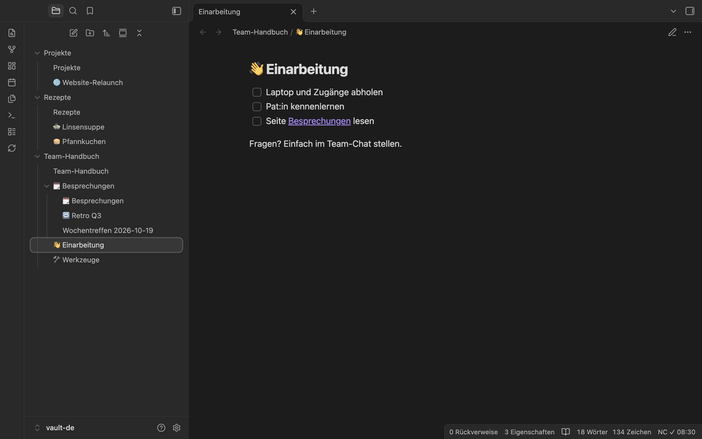
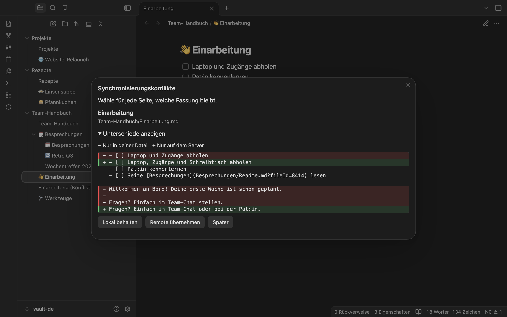
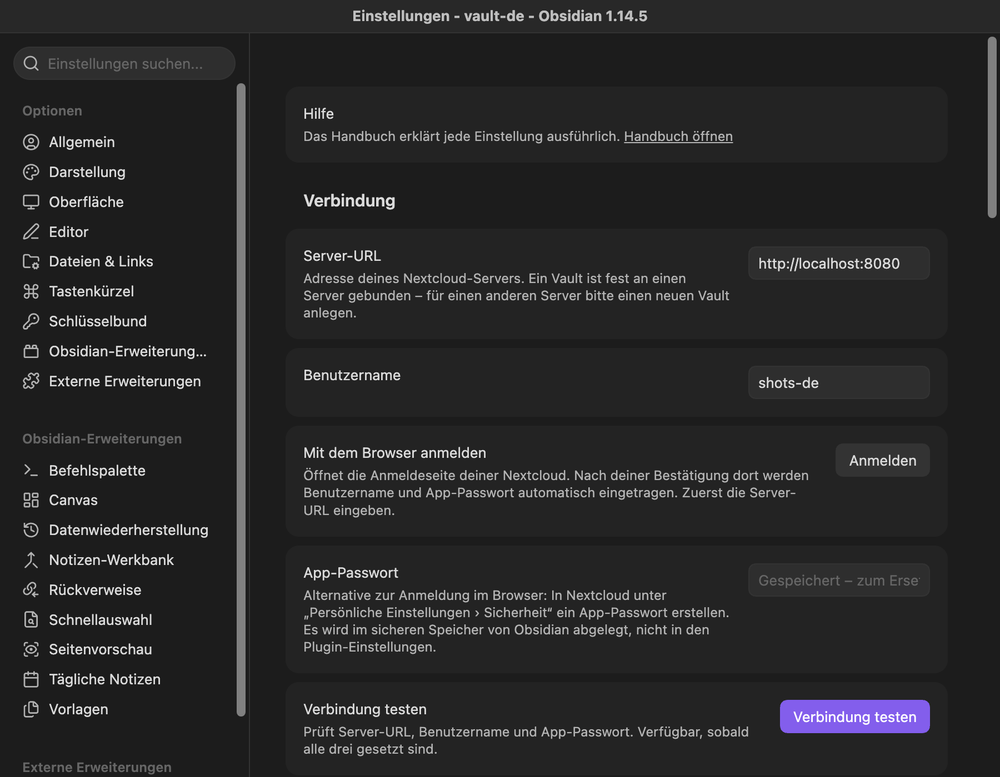
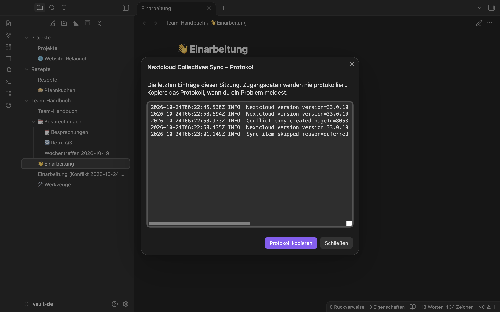

# Nextcloud Collectives Sync

[English](README.md) | **Deutsch**

Ein Obsidian-Plugin, das alle [Nextcloud Collectives](https://apps.nextcloud.com/apps/collectives) eines Nextcloud-Servers in beide Richtungen mit deinem Vault synchronisiert. Jedes Collective wird ein Ordner in deinem Vault, jede Seite eine Notiz. Du schreibst in Obsidian, am Desktop oder auf dem Handy, und deine Kolleginnen und Kollegen arbeiten weiter im Browser in Collectives. Ändern beide Seiten dieselbe Seite, behält das Plugin beide Fassungen, statt eine zu überschreiben.

**Status:** Vorab-Version 0.3.3. Installiere es aus den Community-Plugins von Obsidian (siehe [Installation](#installation)).

> ⚠️ **Haftungsausschluss**
>
> Dieses Plugin wird ohne jegliche Gewährleistung bereitgestellt. Die Nutzung erfolgt auf eigene Gefahr. Der Autor übernimmt keine Verantwortung für beschädigte, überschriebene oder verlorene Notizen oder sonstigen Datenverlust, der durch die Nutzung dieses Plugins entsteht. Lege vor der Nutzung unbedingt ein unabhängiges Backup deines Vaults und deiner Nextcloud Collectives an. Details siehe [MIT-Lizenz](LICENSE).

## Funktionen

- Alle Collectives deines Kontos, jedes als Ordner auf oberster Ebene des Vaults.
- Seiten und ihre Hierarchie: Eine Seite mit Unterseiten ist ein Ordner mit einer gleichnamigen Notiz.
- Neue, umbenannte, verschobene und gelöschte Seiten und Collectives in beide Richtungen. Vor dem Löschen auf dem Server fragt das Plugin nach, und gelöschte Seiten kommen in den Collectives-Papierkorb, wo du sie wiederherstellen kannst.
- Emoji und Tags einer Seite in den Eigenschaften (Frontmatter) der Notiz, in beide Richtungen abgeglichen.
- Links zwischen Seiten: Wikilinks im Vault, Collectives-Links auf dem Server.
- Anhänge (Bilder und andere eingebettete Dateien) in beide Richtungen, mit Größenlimit.
- Konfliktkopien statt Überschreiben, und ein Dialog, in dem du entscheidest, welche Fassung bleibt.
- Automatische Synchronisierung: beim Start, im Intervall, nachdem du aufgehört hast zu schreiben, und wenn du auf dem Handy zur App zurückkehrst.
- Anmeldung im Browser (Nextcloud Login Flow) oder mit App-Passwort. Dein Hauptpasswort wird nie gebraucht.
- Oberfläche auf Deutsch und Englisch.

## Screenshots

Konflikt-Dialog: Du wählst, welche Fassung bleibt.

Löschen auf dem Server erst nach deinem Haken.

Einstellungen: Server, Anmeldung und App-Passwort.

Das Protokoll zum Melden von Fehlern; Zugangsdaten werden nie protokolliert.

## Voraussetzungen

- Obsidian ab 1.11.4 (Desktop, iOS und Android).
- Ein Nextcloud-Server mit der App **Collectives**. Getestet mit Nextcloud 33, 34 und 35 (jeweils mit der dazu passenden Collectives-Version, zuletzt 4.7.1). Bei einer anderen Nextcloud-Hauptversion zeigt das Plugin einmal eine Warnung und synchronisiert trotzdem.
- Ein Nextcloud-Konto. Das Plugin meldet sich per Login Flow oder mit einem App-Passwort an.

## Installation

Lies vor der ersten Synchronisierung den Abschnitt [Risiken und Backup](#risiken-und-backup). Voraussetzung für alle Wege: Unter „Einstellungen › Community plugins“ ist der eingeschränkte Modus aus (Community-Plugins sind erlaubt).

### Aus den Community-Plugins (empfohlen, auch auf dem Handy)

1. In Obsidian „Einstellungen › Community plugins › Durchsuchen“ öffnen und nach **„Nextcloud Collectives Sync“** suchen.
2. **Installieren** wählen, danach **Aktivieren**.

Updates findest und installierst du unter „Einstellungen › Community plugins“ über die Prüfung auf Updates. Die Seite des Plugins im Community-Verzeichnis: [community.obsidian.md/plugins/nextcloud-collectives](https://community.obsidian.md/plugins/nextcloud-collectives).

### Mit BRAT

[BRAT](https://github.com/TfTHacker/obsidian42-brat) installiert Plugins direkt aus dem GitHub-Repository ([Releases](https://github.com/keineantwort/obsidian-nextcloud-collectives/releases)). Nutze es, um bei einem bestimmten Release zu bleiben oder ein neues Release zu bekommen, bevor das Community-Verzeichnis es übernommen hat.

1. In Obsidian unter „Community plugins › Durchsuchen“ das Plugin **„BRAT“** (Obsidian42 – BRAT) installieren und aktivieren.
2. In den Einstellungen von BRAT **„Add beta plugin“** wählen (oder den Befehl „BRAT: Plugins: Add a beta plugin for testing (with or without version)“).
3. Als Repository eintragen: `https://github.com/keineantwort/obsidian-nextcloud-collectives` (oder kurz `keineantwort/obsidian-nextcloud-collectives`).
4. Als Version „Latest version“ lassen (oder ein bestimmtes Release wählen), „Enable after installing the plugin“ anhaken und mit „Add plugin“ bestätigen.
5. Falls das Plugin danach noch nicht aktiv ist: unter „Community plugins“ **„Nextcloud Collectives Sync“** aktivieren.

BRAT prüft danach beim Start von Obsidian auf neue Releases (von Hand: Befehl „BRAT: Plugins: Check for updates to all beta plugins and UPDATE“). Hast du ein bestimmtes Release gewählt, bleibt das Plugin auf diesem Stand, bis du in BRAT eine andere Version einstellst.

Hast du das Plugin früher mit BRAT installiert, ist es dasselbe Plugin wie in den Community-Plugins; Einstellungen und Notizen bleiben erhalten. Soll Obsidian statt BRAT die Updates übernehmen, entferne es in den Einstellungen von BRAT aus der Liste der Beta-Plugins (es wird dabei nicht deinstalliert).

### Von Hand

1. Aus dem [neuesten Release](https://github.com/keineantwort/obsidian-nextcloud-collectives/releases/latest) die Dateien `main.js`, `manifest.json` und `styles.css` herunterladen.
2. Im Vault den Ordner `.obsidian/plugins/nextcloud-collectives/` anlegen und die drei Dateien hineinlegen.
3. Obsidian neu starten (oder unter „Community plugins“ die Liste neu laden) und **„Nextcloud Collectives Sync“** aktivieren.

Auf dem Handy ist der Ordner `.obsidian` versteckt: Bereite den Vault am besten am Desktop vor. Updates installierst du auf diesem Weg ebenfalls von Hand.

Selbst bauen: `npm ci && npm run build` erzeugt `main.js` im Projektordner; `manifest.json` und `styles.css` liegen dort bereits.

## Erste Schritte

1. **Mache eine Sicherung** deines Vault-Ordners und wichtiger Collectives auf dem Server.
2. **Nimm für die erste Synchronisierung einen neuen, leeren Vault.** Ein Vault mit Notizen geht auch, aber das Plugin führt deine Notizen dann mit deinen Collectives zusammen und lädt sie hoch.
3. Öffne die Einstellungen des Plugins und trage die **Server-URL** deiner Nextcloud ein, zum Beispiel `https://cloud.example.com`.
4. Wähle bei „Mit dem Browser anmelden“ **Anmelden** und bestätige den Zugriff in deiner Nextcloud. Benutzername und App-Passwort werden danach automatisch eingetragen. Alternativ trägst du Benutzername und ein App-Passwort von Hand ein.
5. Führe den Befehl **Jetzt synchronisieren** aus (oder klicke auf das Symbol „Mit Nextcloud Collectives synchronisieren“ in der Seitenleiste). Danach synchronisiert das Plugin von selbst.

Ausführlich: [Erste Schritte](docs/user/de/getting-started.md) im Handbuch.

## Risiken und Backup

Das Plugin schreibt in beide Richtungen: in deinen Vault **und** auf deinen Nextcloud-Server. Fehler können Seiten verändern, verschieben oder in den Papierkorb legen.

- **Mache vor der ersten Synchronisierung eine Sicherung** des Vault-Ordners (und bei wichtigen Collectives eine Sicherung auf dem Server). Lege für die erste Synchronisierung am besten einen neuen, leeren Vault an.
- Das Plugin überschreibt nichts still: Bei Konflikten bleibt deine Datei erhalten. Gelöscht wird nur nach Rückfrage und nur in die Papierkörbe (Collectives-Papierkorb auf dem Server, Obsidians Papierkorb im Vault). Siehe [Struktur](docs/user/de/structure.md) und [Konflikte](docs/user/de/conflicts.md).
- **Gleichzeitiges Bearbeiten im Browser** und in Obsidian kann Eingaben im Browser verlieren (siehe [Konflikte](docs/user/de/conflicts.md#gleichzeitig-im-browser-bearbeiten)).
- Ein Vault gehört zu **einem** Server und **einem** Konto. Ein anderes Konto braucht einen neuen Vault.
- Die Collectives-Schnittstelle ist nicht offiziell stabil. Antwortet der Server unerwartet, stoppt das Plugin mit einer Meldung, statt zu raten.
- Das App-Passwort liegt im Secret Storage von Obsidian, nicht in den Plugin-Einstellungen und nie im Protokoll.

## Netzwerk und Datenschutz

Das Plugin verbindet sich **nur mit dem Nextcloud-Server, den du in den Einstellungen einträgst**. Diesen Server braucht es für die Synchronisierung:

- Anmeldung: der Login Flow von Nextcloud (`/index.php/login/v2`, öffnet die Anmeldeseite deines Servers im Browser) oder ein App-Passwort, das du einträgst.
- Versions- und Kontoprüfung: `/ocs/v2.php/cloud/capabilities` und `/ocs/v2.php/cloud/user`.
- Collectives und Seiten: die Schnittstellen von Collectives und Circles (`/ocs/v2.php/apps/collectives/…`, `/ocs/v2.php/apps/circles/…`) und WebDAV (`/remote.php/dav/files/…`) für Seiteninhalte und Anhänge.

Andere Dienste nutzt das Plugin nicht: keine Telemetrie, keine Statistik, keine Update-Prüfung. Links zu diesem Handbuch (zum Beispiel in den Einstellungen) öffnen GitHub im Browser, und zwar nur, wenn du sie anklickst. Das Plugin liest und schreibt Dateien nur in deinem Vault. In die Zwischenablage schreibt es nur, wenn du im Protokoll auf **Protokoll kopieren** tippst, und es liest sie nie.

## Dokumentation

Das Handbuch erklärt alle Teile des Plugins:

- [Erste Schritte](docs/user/de/getting-started.md): Anmeldung, erste Synchronisierung, wie der Vault danach aussieht.
- [Wann synchronisiert wird](docs/user/de/sync.md): automatische und manuelle Synchronisierung, Statusleiste, was nicht synchronisiert wird.
- [Struktur](docs/user/de/structure.md): neue, umbenannte, verschobene und gelöschte Seiten und Collectives.
- [Konflikte](docs/user/de/conflicts.md): Konfliktkopien, der Konflikt-Dialog, die Einstellung „Konflikte“.
- [Emoji, Tags, Links und Anhänge](docs/user/de/tags-emoji-links-attachments.md).
- [Einstellungen](docs/user/de/settings.md): jede Einstellung mit Standardwert und Risiken.
- [Befehle und Menüs](docs/user/de/commands.md).
- [Hilfe bei Problemen](docs/user/de/troubleshooting.md): Protokoll, Fehlermeldungen, häufige Fragen.

## Hilfe und Fehler melden

Der Befehl **Protokoll anzeigen** (auch in den Einstellungen unter „Diagnose“) zeigt, was das Plugin in dieser Sitzung getan hat, und kopiert es. Mit der Einstellung „Ausführliches Protokoll“ steht zusätzlich jede Anfrage an den Server darin (Methode, Pfad, Status, Dauer; nie Passwörter oder Inhalte). Das Protokoll liegt nur im Speicher und ist nach einem Neustart weg. Mehr in [Hilfe bei Problemen](docs/user/de/troubleshooting.md).

Fehler und Ideen meldest du als [GitHub-Issue](https://github.com/keineantwort/obsidian-nextcloud-collectives/issues). Hänge das Protokoll an und prüfe es vorher auf alles, was du nicht teilen möchtest.

## Mitmachen

Siehe [CONTRIBUTING.md](CONTRIBUTING.md) (auf Englisch).

## Lizenz

[MIT](LICENSE)

Dank an [Nextcloud Sync](https://github.com/siosig/obsidian-nextcloudsync) von Daisuke ITO (MIT): Anmeldung, Konfliktbehandlung und das Auslesen der WebDAV-Antworten dienten als Vorbild. Code wurde nicht übernommen.
