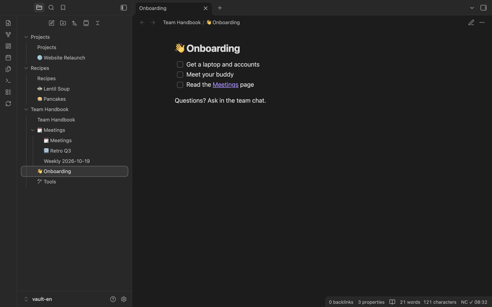
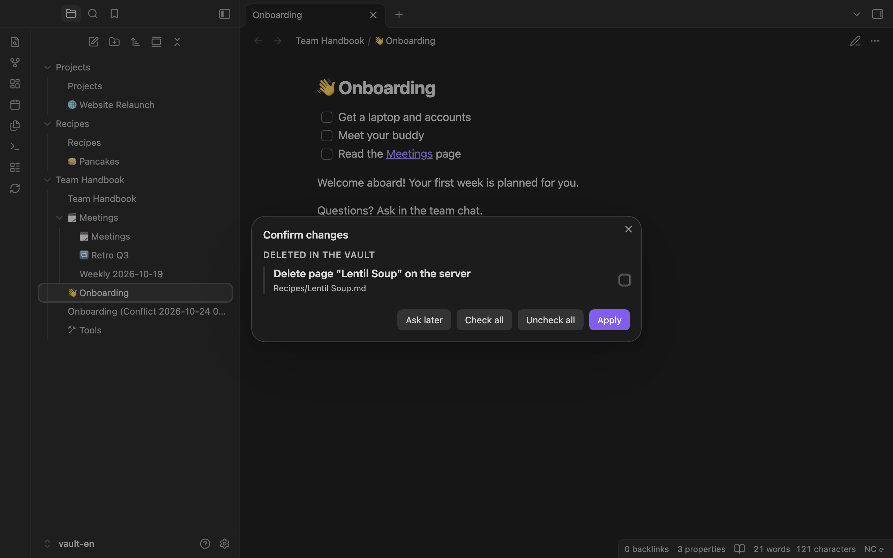

# Nextcloud Collectives Sync

**English** | [Deutsch](README.de.md)

An Obsidian plugin that syncs all [Nextcloud Collectives](https://apps.nextcloud.com/apps/collectives) of a Nextcloud server with your vault, in both directions. Each collective becomes a folder in your vault, each page a note. You edit in Obsidian, on desktop or on your phone, and your colleagues keep working in Collectives in the browser. When both sides change the same page, the plugin keeps both versions instead of overwriting one.

**Status:** pre-release, version 0.3.2. The plugin is not in the Obsidian community store yet; install it with BRAT or by hand (see [Installation](#installation)).

## Features

- All collectives of your account, each as a top-level folder of the vault.
- Pages and their hierarchy: a page with sub-pages is a folder with a note of the same name.
- New, renamed, moved and deleted pages and collectives in both directions. Deleting on the server asks you first, and deleted pages go to the Collectives trash, where you can restore them.
- Page emoji and tags in the note's properties (frontmatter), synced both ways.
- Links between pages: Obsidian wikilinks in the vault, Collectives links on the server.
- Attachments (images and other embedded files) in both directions, with a size limit.
- Conflict copies instead of overwrites, and a dialog to decide which version to keep.
- Automatic sync: on startup, at an interval, after you stop editing, and when you return to the app on your phone.
- Sign-in with the browser (Nextcloud Login Flow) or with an app password. Your main password is never needed.
- User interface in English and German.

## Screenshots

Conflict dialog: choose which version to keep.

Deleting on the server needs your tick first.

Settings: server, sign-in and app password.

The log for reporting problems; credentials are never logged.

## Requirements

- Obsidian 1.11.4 or later (desktop, iOS and Android).
- A Nextcloud server with the **Collectives** app. Tested with Nextcloud 33, 34 and 35, each with its matching Collectives version (most recently 4.7.1). With another major version of Nextcloud, the plugin shows a warning once and keeps syncing.
- A Nextcloud account. The plugin signs in with the Login Flow or with an app password.

## Installation

The plugin is not in the Obsidian community store yet. Releases are published on GitHub: [keineantwort/obsidian-nextcloud-collectives](https://github.com/keineantwort/obsidian-nextcloud-collectives/releases). Read [Risks and backup](#risks-and-backup) before your first sync.

For both ways, restricted mode must be off: in Obsidian under "Settings › Community plugins", community plugins must be allowed.

### With BRAT (recommended, also on your phone)

[BRAT](https://github.com/TfTHacker/obsidian42-brat) installs plugins straight from a GitHub repository and keeps them up to date.

1. In Obsidian, under "Community plugins › Browse", install and enable the plugin **"BRAT"** (Obsidian42 – BRAT).
2. In the settings of BRAT, choose **"Add beta plugin"** (or run the command "BRAT: Plugins: Add a beta plugin for testing (with or without version)").
3. Enter the repository: `https://github.com/keineantwort/obsidian-nextcloud-collectives` (or short: `keineantwort/obsidian-nextcloud-collectives`).
4. Leave the version at "Latest version" (or pick a specific release), tick "Enable after installing the plugin" and confirm with "Add plugin".
5. If the plugin is not enabled afterwards: enable **"Nextcloud Collectives Sync"** under "Community plugins".

From then on, BRAT checks for new releases when Obsidian starts (by hand: command "BRAT: Plugins: Check for updates to all beta plugins and UPDATE"). If you picked a specific release, the plugin stays at that version until you choose another one in BRAT.

### By hand

1. Download `main.js`, `manifest.json` and `styles.css` from the [latest release](https://github.com/keineantwort/obsidian-nextcloud-collectives/releases/latest).
2. In your vault, create the folder `.obsidian/plugins/nextcloud-collectives/` and put the three files into it.
3. Restart Obsidian (or reload the list under "Community plugins") and enable **"Nextcloud Collectives Sync"**.

On a phone, the `.obsidian` folder is hidden, so it is easiest to prepare the vault on a desktop computer. With this way, you also install updates by hand.

To build it yourself: `npm ci && npm run build` creates `main.js` in the project folder; `manifest.json` and `styles.css` are already there.

## Getting started

1. **Make a backup** of your vault folder, and of important collectives on the server.
2. **Use a new, empty vault** for the first sync. A vault that already contains notes works too, but the plugin then merges your notes into your collectives and uploads them.
3. Open the plugin settings and enter the **Server URL** of your Nextcloud, for example `https://cloud.example.com`.
4. Choose **Sign in** next to "Sign in with the browser" and confirm the access in your Nextcloud. Username and app password are filled in automatically. Alternatively, enter your username and an app password by hand.
5. Run the command **Sync now** (or click the ribbon icon "Sync with Nextcloud Collectives"). After that, the plugin syncs by itself.

Details: [Getting started](docs/user/en/getting-started.md) in the manual.

## Risks and backup

The plugin writes in both directions: into your vault **and** to your Nextcloud server. A bug can change, move or trash pages.

- **Make a backup before the first sync** of your vault folder (and, for important collectives, on the server). Ideally, create a new, empty vault for the first sync.
- The plugin never overwrites silently: in a conflict your file is kept. It deletes only after asking, and only into the trash (Collectives trash on the server, Obsidian's trash in the vault). See [Structure](docs/user/en/structure.md) and [Conflicts](docs/user/en/conflicts.md).
- **Editing the same page in the browser** and in Obsidian at the same time can lose what you type in the browser (see [Conflicts](docs/user/en/conflicts.md#editing-in-the-browser-at-the-same-time)).
- A vault belongs to **one** server and **one** account. Another account needs a new vault.
- The Collectives interface is not officially stable. If the server answers in an unexpected way, the plugin stops with a message instead of guessing.
- The app password is kept in Obsidian's secret storage, not in the plugin settings, and never in the log.

## Network use and privacy

The plugin connects **only to the Nextcloud server you enter in the settings**. It needs that server to sync:

- Sign-in: the Nextcloud Login Flow (`/index.php/login/v2`, opens the login page of your server in the browser) or an app password you enter.
- Version and account check: `/ocs/v2.php/cloud/capabilities` and `/ocs/v2.php/cloud/user`.
- Collectives and pages: the Collectives and Circles interfaces (`/ocs/v2.php/apps/collectives/…`, `/ocs/v2.php/apps/circles/…`) and WebDAV (`/remote.php/dav/files/…`) for page contents and attachments.

The plugin uses no other services: no telemetry, no analytics, no update checks. Links to this manual (for example in the settings) open GitHub in your browser only when you click them. The plugin reads and writes files only inside your vault. It writes to the clipboard only when you press **Copy log** in the log view, and it never reads the clipboard.

## Documentation

The user manual explains every part of the plugin:

- [Getting started](docs/user/en/getting-started.md): sign-in, first sync, what the vault looks like afterwards.
- [When the plugin syncs](docs/user/en/sync.md): automatic and manual sync, status bar, what is not synced.
- [Structure](docs/user/en/structure.md): new, renamed, moved and deleted pages and collectives.
- [Conflicts](docs/user/en/conflicts.md): conflict copies, the conflict dialog, the conflict setting.
- [Emoji, tags, links and attachments](docs/user/en/tags-emoji-links-attachments.md).
- [Settings](docs/user/en/settings.md): every setting with its default and its risks.
- [Commands and menus](docs/user/en/commands.md).
- [Troubleshooting](docs/user/en/troubleshooting.md): log, error messages, FAQ.

## Help and reporting problems

The command **Show log** (also in the settings under "Diagnostics") shows what the plugin did in this session and lets you copy it. With the setting "Detailed log", every request to the server is listed too (method, path, status, duration; never passwords or contents). The log is kept in memory only and is gone after a restart. More in [Troubleshooting](docs/user/en/troubleshooting.md).

Report bugs and ideas as [GitHub issues](https://github.com/keineantwort/obsidian-nextcloud-collectives/issues). Attach the log, and check it first for anything you do not want to share.

## Contributing

See [CONTRIBUTING.md](CONTRIBUTING.md).

## License

[MIT](LICENSE)

Thanks to [Nextcloud Sync](https://github.com/siosig/obsidian-nextcloudsync) by Daisuke ITO (MIT): its sign-in, conflict handling and WebDAV parsing served as a reference. No code was copied.
