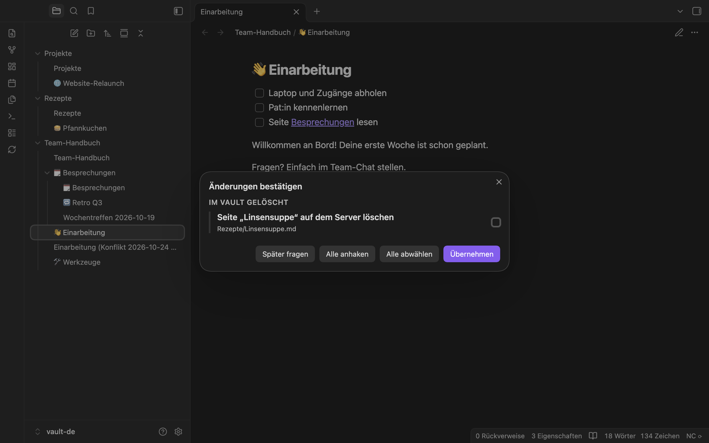

[English](../en/structure.md) | **Deutsch**

# Struktur: neue, umbenannte, verschobene und gelöschte Seiten

[Handbuch](README.md) › Struktur

Das Plugin gleicht auch die Struktur ab, nicht nur den Text. Jedes Collective ist ein Ordner auf oberster Ebene des Vaults. Eine Seite mit Unterseiten ist ein Ordner mit einer gleichnamigen Notiz darin (`Handbuch/Prozesse/Prozesse.md`). Über die Eigenschaft `nc_page_id` weiß das Plugin, zu welcher Seite eine Notiz gehört; eine Notiz behält ihre Seite also, wohin du sie auch verschiebst.

## Änderungen im Vault

| Du machst im Vault … | … das passiert auf dem Server |
|---|---|
| eine neue Notiz in einem Collective-Ordner anlegen | Sie wird als neue Seite hochgeladen, ihre `nc_page_id` steht danach in der Notiz. Die Seite hängt unter der Seite, der ihr Ordner gehört. Hat der Ordner keine eigene Notiz, legt das Plugin für ihn eine Ordnerseite an (mit leerer Notiz). |
| neben einer Notiz einen gleichnamigen Ordner anlegen und eine neue Notiz hineinlegen (`Onboarding.md` und `Onboarding/Neu.md`) | Die neue Notiz wird Unterseite von „Onboarding“. Das Plugin verschiebt danach `Onboarding.md` in den Ordner (`Onboarding/Onboarding.md`). |
| eine Notiz umbenennen oder in einen anderen Ordner verschieben | Die Seite wird umbenannt bzw. verschoben, auch in ein anderes Collective. ID und Emoji bleiben; die Tags der Notiz werden im neuen Collective neu zugewiesen. |
| den Ordner einer Seite mit Unterseiten umbenennen, oder nur die Notiz darin | Die Seite heißt danach wie der Ordner bzw. die Notiz; Ordner und Notiz bekommen denselben Namen. |
| einen neuen Ordner auf oberster Ebene mit Notizen anlegen | Ein neues Collective entsteht (Einstellung [Neue Ordner auf oberster Ebene](settings.md#neue-ordner-auf-oberster-ebene)). Die Notiz, die wie der Ordner heißt, wird die Startseite. |
| den Ordner eines Collectives umbenennen | Das Collective wird umbenannt. Das dürfen nur Admins und Eigentümer des Collectives; sonst wird der Ordner zurückbenannt, und du siehst „Du darfst ein Collective nicht umbenennen. Der Ordnername wurde zurückgesetzt.“ |
| eine Notiz oder einen Ordner löschen | Das Plugin **fragt**, bevor eine Seite auf dem Server in den Collectives-Papierkorb kommt (Einstellung [Notizen in diesem Vault löschen](settings.md#notizen-in-diesem-vault-löschen)). Eine Seite mit Unterseiten wird samt Unterseiten gelöscht. |
| den Ordner eines Collectives löschen | Das Plugin fragt immer, bevor das Collective auf dem Server in den Papierkorb kommt. Nur Admins und Eigentümer dürfen ein Collective löschen; sonst wird der Ordner wiederhergestellt, und du siehst „Du darfst ein Collective nicht löschen. Der Ordner wurde wiederhergestellt.“ |
| eine gelöschte Notiz (mit ihrer `nc_page_id`) wieder in den Vault legen | Die Seite wird aus dem Collectives-Papierkorb wiederhergestellt. |

Eine Seite mit Unterseiten benennst du am einfachsten mit dem Menüeintrag **Seite umbenennen …** (oder dem Befehl **Seite umbenennen**) um: Er benennt Notiz und Ordner zusammen um. Siehe [Befehle und Menüs](commands.md).

## Änderungen auf dem Server

- Eine auf dem Server umbenannte oder verschobene Seite wird im Vault umbenannt bzw. verschoben. Obsidian passt die Links darauf an.
- Haben du und jemand auf dem Server dieselbe Seite an verschiedene Orte verschoben, gilt der Ort auf dem Server. Du siehst „1 Seite wurde auf beiden Seiten verschoben. Es gilt der Ort auf dem Server.“
- Eine auf dem Server gelöschte Seite kommt im Vault in den Papierkorb, wie in Obsidian eingestellt (Einstellung [Auf dem Server gelöschte Seiten](settings.md#auf-dem-server-gelöschte-seiten); „Datei behalten“ lädt sie als neue Seite wieder hoch).
- Hast du die Notiz seit der letzten Synchronisierung geändert, wird sie **nie** entfernt. Stattdessen wird die Seite aus dem Collectives-Papierkorb wiederhergestellt und deine Änderung hochgeladen.
- Hat sich eine Seite auf dem Server geändert, während du sie im Vault gelöscht hast, kommt sie ohne Rückfrage zurück: Die Änderung gewinnt.
- Ein neues Collective auf dem Server wird ein neuer Ordner auf oberster Ebene.
- Ein auf dem Server gelöschtes Collective (oder eins, das du verlassen hast) wird nur nach Rückfrage aus dem Vault entfernt. Lässt du es unangehakt und wählst **Übernehmen**, bleibt der Ordner, und das Plugin vergisst, dass er zum alten Collective gehörte. Ab dann gilt er als neuer Ordner auf oberster Ebene und wird mit der Standardeinstellung als neues Collective hochgeladen.

## Der Bestätigungsdialog

Rückfragen sammelt das Plugin in einem Dialog, **Änderungen bestätigen**, gruppiert nach „Im Vault gelöscht“, „Auf dem Server gelöscht“ und „Neu im Vault“. Jede Zeile sagt, was passiert, wenn du sie anhakst, zum Beispiel „Seite „Urlaub“ auf dem Server löschen“, mit Pfad und Zahl der Unterseiten.

- **Anfangs ist nichts angehakt.** Was du anhakst, passiert; was du nicht anhakst, nicht. Eine im Vault gelöschte Seite, die du nicht anhakst, kommt in den Vault zurück.
- **Alle anhaken** und **Alle abwählen** ändern alle Kästchen auf einmal.
- **Übernehmen** führt deine Auswahl aus.
- **Später fragen**, Esc oder Schließen des Dialogs ändert nichts. Das Plugin fragt bei der nächsten Synchronisierung erneut.

Automatische Läufe öffnen diesen Dialog nicht. Sie stellen die Rückfragen zurück, bis du **Jetzt synchronisieren** ausführst; siehe [Wann synchronisiert wird](sync.md#automatische-läufe-sind-still).

## Schutz vor Massenlöschung

Löschst du mindestens 3 Seiten und mehr als 20 % der Seiten eines Collectives auf einmal, fragt das Plugin immer, auch mit der Einstellung „Ohne Rückfrage in den Collectives-Papierkorb“. Die Zeile zeigt dann eine Warnung wie „12 von 40 Seiten von „Handbuch““.

## Papierkorb auf beiden Seiten

Nichts wird endgültig gelöscht:

- Auf dem Server kommen Seiten und Collectives in den Collectives-Papierkorb, wo du sie wiederherstellen kannst.
- Im Vault kommen Notizen und Ordner in den Papierkorb, wie in Obsidian eingestellt („Einstellungen › Dateien und Links › Gelöschte Dateien“).

## Namen

Manche Zeichen sind in Dateinamen von Obsidian nicht erlaubt (`* " \ / < > : | ? # ^ [ ]`). Enthält ein Seitentitel eins davon, steht im Dateinamen `_`, und der echte Titel bleibt in der Eigenschaft `nc_title` erhalten. Würden zwei Seiten denselben Dateinamen bekommen, erhält die zweite eine Nummer, etwa `Urlaub (2).md`.
