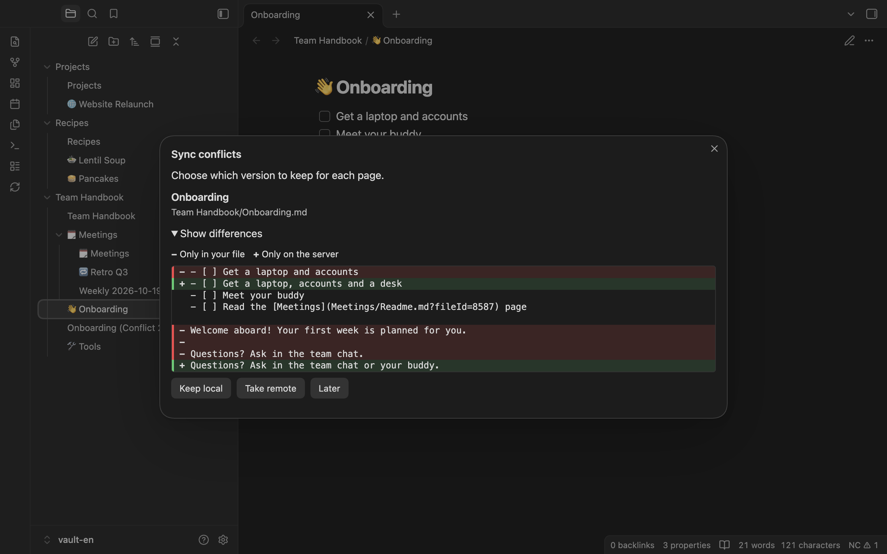

**English** | [Deutsch](../de/conflicts.md)

# Conflicts

[Manual](README.md) › Conflicts

## When a conflict happens

A conflict happens when a page was changed both in the vault and on the server since the last sync, and the two versions differ. If both sides made the same change, there is no conflict.

With the default setting ("Keep both (conflict copy)"), the plugin overwrites nothing:

- Your file stays unchanged.
- The server version is saved next to it as `Title (Conflict YYYY-MM-DD HHmm).md`. This copy is not synced. With Obsidian in German, the copy is called `Titel (Konflikt …).md`.
- The page is not uploaded again until you have resolved the conflict.
- If the server version changes again before you have resolved the conflict, the plugin updates the conflict copy with it; the name keeps the time of the first conflict. If you edited the conflict copy yourself, it stays as it is and a further copy is created.

The sync summary says so: "1 conflict: your file was kept, and the server version was saved next to it with “Conflict” in its name. Use the command “Show conflicts” to decide which version to keep."

Emoji and tags follow the same rule. If they were changed on both sides, the note keeps its values and the conflict copy has the server's values.

## Collisions

A collision is a special case of the first sync: a file from your vault was already at the place where a server page should go, and the file has no `nc_page_id`. Your file stays here too, and the server page is saved next to it as a conflict copy. The conflict dialog marks it with "A file with this name already existed in your vault."

Attachments can collide as well. If an image in the vault and on the server have the same name but different content, the server's file is saved next to yours as `name (Conflict …).png`.

## The conflict dialog

Open conflicts are shown in the status bar as `NC ⚠︎ n` (desktop only); click it to open the dialog. The command **Show conflicts** opens it too; on phones it is the only way. If there are no conflicts, you see "There are no open conflicts."

The dialog **Sync conflicts** lists every page with a conflict. For each page, "Show differences" shows the lines that are "Only in your file" and "Only on the server". The first page is opened right away. Very large files show "Too large to compare here."

| Choice | Effect |
|---|---|
| **Keep local** | Your file is uploaded and replaces the server version. If the server version has changed again in the meantime, you get a new conflict instead of an overwrite ("The server version of “…” changed again in the meantime, so there is a new conflict."). For a collision, your file is linked to the server page. |
| **Take remote** | The content of your file is replaced with the server version. The plugin downloads the server version again for this, so the conflict copy does not have to be there any more. |
| **Later** | Everything stays as it is. |

After **Keep local** or **Take remote**, the conflict copy is moved to the trash, as set in Obsidian, and a sync runs right away. When all conflicts are resolved, the dialog says "All conflicts are resolved." and offers **Close**.

You can also resolve a conflict by hand: edit your file until it is right, then choose **Keep local**.

## The setting "Conflicts"

The setting [Conflicts](settings.md#conflicts) in the section "Behaviour" decides what happens when a page was changed on both sides:

- **Keep both (conflict copy)**: the default, as described above.
- **Prefer this vault (overwrites the server)**: the server version is overwritten without asking.
- **Prefer the server (overwrites this vault)**: your file is overwritten without asking.

With the two "Prefer" options, the changes made on the other side are lost. The settings show a warning when you choose one of them. Pages that already have a conflict still need your decision in the conflict dialog.

## Editing in the browser at the same time

If the plugin uploads a page while it is open in the Collectives editor in the browser, the editor shows "Editing session has expired. Please reload the page." Reload the page then. Anything you type in the browser after that message is not saved.

The plugin protects the server side: if the browser saved the page after the plugin last read it, the upload fails and you get a conflict instead of an overwrite. It does not take part in the browser's live editing session. Background: [ADR 0012](../../adr/0012-concurrent-editing-in-the-browser.md).

If the server did not confirm the current version of a page, the plugin does not upload it and tries again in the next sync: "1 page was not sent: the server did not confirm its current version. It will be retried on the next sync."
