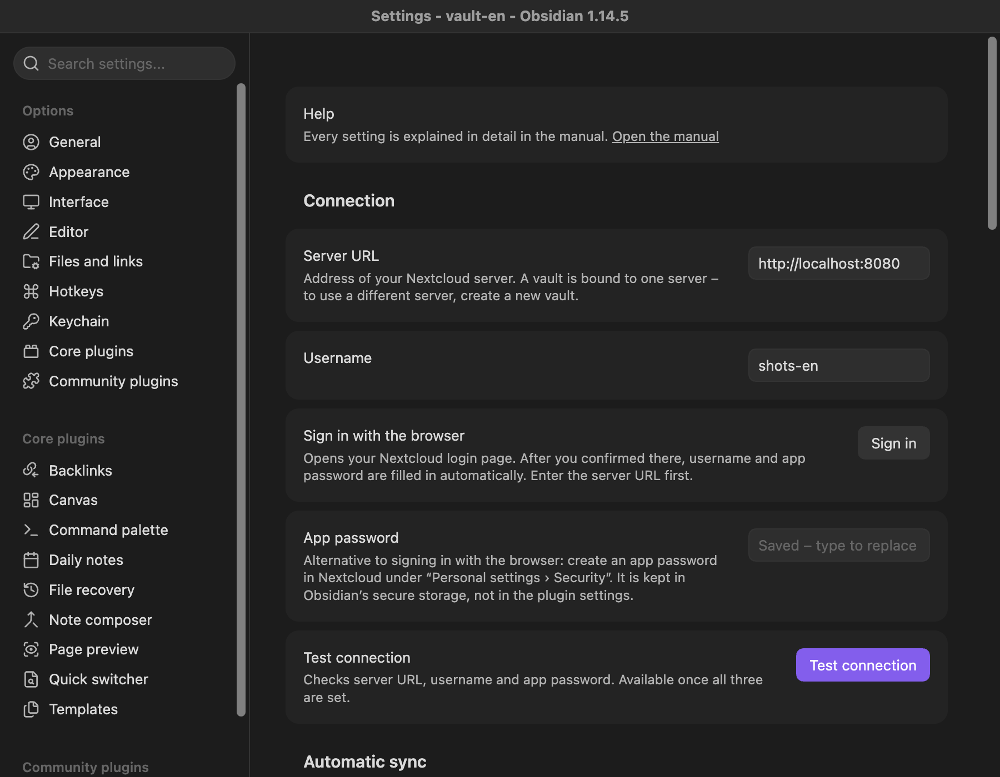

**English** | [Deutsch](../de/settings.md)

# Settings

[Manual](README.md) › Settings

Open "Settings › Nextcloud Collectives Sync". At the top, **Help** has a link "Open the manual" to this page. The settings are listed here in the order of the settings tab. Text and number fields are saved when you leave the field or press Enter. An invalid value is not saved: you see a message, and the field shows the saved value again. In Obsidian 1.13 or newer, the settings search finds these settings by name, description and keywords such as "password" or "conflict".

Contents:

- [Connection](#connection): [Server URL](#server-url), [Username](#username), [Sign in with the browser](#sign-in-with-the-browser), [App password](#app-password), [Test connection](#test-connection)
- [Automatic sync](#automatic-sync): [Sync interval (minutes)](#sync-interval-minutes), [Sync on startup](#sync-on-startup), [Sync when returning to Obsidian](#sync-when-returning-to-obsidian), [Sync after changes](#sync-after-changes), [Wait after the last change (seconds)](#wait-after-the-last-change-seconds)
- [Behaviour](#behaviour): [Conflicts](#conflicts), [New top-level folders](#new-top-level-folders), [Deleting notes in this vault](#deleting-notes-in-this-vault), [Pages deleted on the server](#pages-deleted-on-the-server), [Attachment folder](#attachment-folder), [Largest attachment (MB)](#largest-attachment-mb), [Delete attachments on the server](#delete-attachments-on-the-server), [Hide the plugin’s properties](#hide-the-plugins-properties), [Show the page of a folder first](#show-the-page-of-a-folder-first), [Show page emoji in titles](#show-page-emoji-in-titles)
- [Diagnostics](#diagnostics): [Log](#log), [Detailed log](#detailed-log)
- [Support](#support)

## Connection

### Server URL

The address of your Nextcloud server, for example `https://cloud.example.com`.

- Default: empty.
- If you leave out `https://`, the plugin adds it. A sub-path (`https://example.com/nextcloud`) is allowed; a trailing `/index.php` is ignored. Query strings (`?…`), anchors (`#…`) and user names in the address are not allowed.
- With `http://` to another computer, a warning appears below the field: "Warning: with http:// the app password is sent unencrypted. Use https:// for servers outside this device." The browser sign-in does not work with such an address.
- **A vault is bound to one server.** Once a vault has been synced, a sync with another server address stops with a message and changes nothing. For another server, create a new vault.

### Username

Your Nextcloud login name. The browser sign-in fills it in.

- Default: empty.
- Once a vault has been synced with one account, a sync with another account on the same server stops with a message and changes nothing. For another account, create a new vault.

### Sign in with the browser

Button **Sign in**. Opens your Nextcloud login page in the browser (Nextcloud Login Flow). After you have logged in and allowed the access there, username and app password are filled in automatically, and you see "Signed in as … The app password is saved."

- Enter the server URL first.
- While the plugin waits, the button reads **Cancel**, and a link "Open the login page again" appears (in case the browser did not open).
- The login page expires after 20 minutes: "The login page expired. Please try again."
- Needs `https://` (or an address on this device). With `http://` you see "Sign-in in the browser needs https:// – with http:// the app password would travel unencrypted. Use https:// or enter an app password by hand."
- If you change the server URL while the plugin waits, the new app password is not stored.
- Each sign-in creates a new app password in Nextcloud. You can see and revoke them in Nextcloud under "Personal settings › Security".

### App password

The alternative to the browser sign-in: create an app password in Nextcloud under "Personal settings › Security" and paste it here.

- Default: empty.
- The password is stored in Obsidian's secret storage, not in the plugin settings (`data.json`), and is never shown again. Once one is stored, the field shows "Saved – type to replace". Type a new one to replace it.
- Do not use your main Nextcloud password.

### Test connection

Button **Test connection**. Checks server URL, username and app password and counts your collectives, for example "Connection successful: 3 collectives found." It is available once all three are set. Error messages are explained in [Troubleshooting](troubleshooting.md#connection-test-and-sign-in).

## Automatic sync

See [When the plugin syncs](sync.md) for how the triggers work together.

### Sync interval (minutes)

How often the plugin syncs by itself while Obsidian is open.

- Default: `5`.
- Values: a whole number from `0` to `1440`. `0` turns the interval off.
- On phones, the interval only runs while Obsidian is in the foreground.

### Sync on startup

Syncs once when Obsidian has loaded the vault (about 2 seconds later).

- Default: on.

### Sync when returning to Obsidian

Syncs when Obsidian becomes visible again, for example when you switch back to the app on your phone or to the Obsidian window on the desktop. At most once within 30 seconds of the last automatic sync.

- Default: on.
- On a phone this is what keeps the vault up to date, because the operating system suspends Obsidian in the background and the interval does not run there. Turn it off if you want to sync on your phone only by hand.
- With this off, "Sync interval (minutes)" set to 0 and "Sync on startup" and "Sync after changes" off, the plugin never syncs on its own; **Sync now** still works.

### Sync after changes

Syncs a few seconds after you stopped editing a synced note. Creating, renaming, moving and deleting synced notes count as changes too. Obsidian saves automatically while you type, so there is no separate save action.

- Default: on.
- Each such sync is a full run over all collectives.

### Wait after the last change (seconds)

How long the plugin waits after your last change before "Sync after changes" starts a sync. Every further change restarts the wait.

- Default: `10`.
- Values: a whole number from `2` to `600`.
- Only used if "Sync after changes" is on.
- A short wait brings your changes to the server sooner, but runs more syncs while you work.

## Behaviour

### Conflicts

What happens when a page was changed both in this vault and on the server since the last sync. More in [Conflicts](conflicts.md).

- Default: **Keep both (conflict copy)**.
- Options:
  - **Keep both (conflict copy)**: keeps your file, saves the server version next to it and lets you decide later with "Show conflicts".
  - **Prefer this vault (overwrites the server)**: the server version is overwritten without asking.
  - **Prefer the server (overwrites this vault)**: your file is overwritten without asking.
- Risk: with both "Prefer" options, the changes made on the other side are lost. A warning below the setting says so. Pages that already have a conflict still need your decision.
- Also applies to emoji and tags.

### New top-level folders

What happens when you create a folder at the top level of the vault and put notes in it. On the server, a top-level folder is a collective.

- Default: **Create a collective**.
- Options:
  - **Create a collective**: a new collective with the folder's name is created on the server. The note with the folder's name becomes the start page; the other notes become pages.
  - **Ask first**: the sync asks in the [confirmation dialog](structure.md#the-confirmation-dialog) ("Create collective “…” on the server"). If you leave it unticked, the folder is left alone in this sync and you are asked again in the next one.
  - **Ignore the folder**: the folder is not synced.
- Risk: with the default, any top-level folder with notes in it is uploaded, including folders that were in the vault before the first sync. Choose "Ask first" if you keep other notes in the same vault.
- Folders without notes are never uploaded.

### Deleting notes in this vault

What happens on the server when you delete a synced note or folder in the vault. Deleted pages go to the Collectives trash on the server, where they can be restored.

- Default: **Ask first**.
- Options:
  - **Ask first**: shows a list in the [confirmation dialog](structure.md#the-confirmation-dialog) before anything is deleted on the server. What you leave unticked comes back into the vault.
  - **Move to the Collectives trash without asking**: deleted notes are deleted on the server without a question.
- Deleting a whole collective (its top-level folder) is always confirmed. So is deleting many pages at once (at least 3 pages and more than 20 % of a collective), see [Mass-deletion guard](structure.md#mass-deletion-guard).

### Pages deleted on the server

What happens to your file when its page was deleted on the server.

- Default: **Move the file to the trash**.
- Options:
  - **Move the file to the trash**: the note goes to the trash as set in Obsidian. Attachments of the page that were deleted on the server go there too.
  - **Keep the file (it is uploaded as a new page)**: the note stays and is uploaded as a new page with a new page ID. Attachments deleted on the server stay in the vault.
- A file you changed since the last sync is never removed: the page is restored from the Collectives trash instead, and your change is uploaded.
- A whole collective that was deleted on the server, or that you left, is always confirmed first.

### Attachment folder

Where downloaded attachments are saved, relative to the folder of the note. `{title}` stands for the name of the note.

- Default: `_attachments/{title}` (for `Handbook/Onboarding.md`: `Handbook/_attachments/Onboarding/`).
- Values: plain folder names separated by `/`. Not allowed: a leading dot, `..`, and any of `* " \ < > : | ? # ^ [ ]`. Leading and trailing `/` are removed.
- Files you embed from elsewhere in the vault stay where they are; only downloaded files go here.
- A change applies to attachments downloaded from then on. Files already in the vault are not moved.

### Largest attachment (MB)

Bigger files are neither uploaded nor downloaded.

- Default: `20`.
- Values: a whole number from `1` to `1000`.
- If you raise the limit, files that were too big before are fetched when the text of their page changes on the server next time.
- Large attachments take time and mobile data, especially on a phone.

### Delete attachments on the server

When you delete an attachment file in the vault and no note uses it any more, it is moved to the Collectives trash on the server too.

- Default: on.
- Off: the file stays on the server; the plugin just stops tracking it.

### Hide the plugin’s properties

Hides the plugin's properties (`nc_page_id`, `nc_collective_id`, `nc_emoji`, `nc_title`) in the properties of a note. Set the emoji with the command or the context menu; tags are in the property "tags", which stays visible.

- Default: on.
- Only the display changes. If the properties are shown, they appear with readable names: "Page ID", "Collective ID", "Emoji", "Page title".

### Show the page of a folder first

In the file list, the note that belongs to a folder (`Folder/Folder.md`) is shown first in that folder, whatever the sort order.

- Default: on.
- Only the display changes.

### Show page emoji in titles

Shows the emoji of a page in front of the note's title in the file list and in the note header.

- Default: on.
- Only the display changes, not the file name.

## Diagnostics

### Log

Button **Show log**. Shows what the plugin did in this session; the same as the command **Show log**. See [Troubleshooting](troubleshooting.md#the-log).

### Detailed log

Also logs every request to the server: method, path, status and duration. Passwords and page contents are never logged.

- Default: off.
- Turn it on when you are looking into a problem, then turn it off again. The paths contain your username and the names of collectives and pages, so check the log before you share it.

## Support

At the very end of the settings tab, **Support** has a link "Say thanks on Ko-fi". The plugin is free and stays free; a tip on [Ko-fi](https://ko-fi.com/keineantwort) is voluntary and gets you nothing in return. The link opens in your browser only when you click it. The plugin shows no other reminder: no message, no pop-up, nothing in the status bar.
