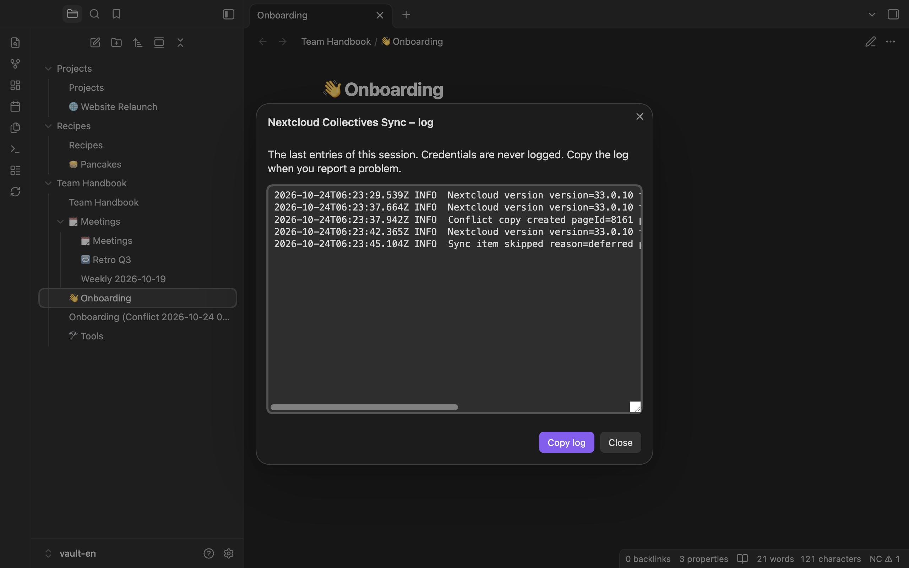

**English** | [Deutsch](../de/troubleshooting.md)

# Troubleshooting

[Manual](README.md) › Troubleshooting

## The log

The command **Show log** (also the button **Show log** in the settings under "Diagnostics") opens "Nextcloud Collectives Sync – log". It shows the last entries of this session: syncs, warnings, errors, the Nextcloud version. **Copy log** copies it to the clipboard.

- Credentials are never logged.
- When the server refuses an operation, the entry contains the server's reason as `detail` (for example `Tag already exists for collective: Projekt`). It can contain names of collectives, pages or tags, never passwords or page contents.
- The log is kept in memory only (the last 500 entries) and is gone after a restart of Obsidian. Copy it right after the problem happened.
- With the setting [Detailed log](settings.md#detailed-log), every request to the server is listed too (method, path, status, duration; never passwords or contents). The paths contain your username and the names of collectives and pages.

When you report a problem, attach the log. Report problems as [GitHub issues](https://github.com/keineantwort/obsidian-nextcloud-collectives/issues).

## Connection test and sign-in

These messages appear in the settings after **Test connection** or **Sign in**, and after "Sync stopped." when a sync fails.

| Message | What to do |
|---|---|
| Please enter the server URL. | Enter the address of your Nextcloud in "Server URL". |
| The server URL is invalid. Example: `https://cloud.example.com` | Enter only the address, without `?…` or `#…` and without a username in it. |
| Please enter the username. | Enter your username, or use "Sign in". |
| Please enter an app password. | Enter an app password, or use "Sign in". |
| Login failed. Please check username and app password. | The app password is wrong or was revoked in Nextcloud. Sign in again or create a new app password. Automatic syncs pause until you do. |
| Access denied (HTTP 403). Please check that the Collectives app is enabled for your account. | Your administrator may have limited the Collectives app to certain groups. |
| The Collectives API was not found. Please check the server URL and make sure the Collectives app is enabled on the server. | Check the address (a sub-path such as `/nextcloud` must be included) and ask your administrator whether Collectives is installed. |
| The server cannot be reached. Please check the server URL and your network connection. | Check your network and the address. Automatic syncs try again later without a message. |
| The server responded with an error (HTTP …). | A problem on the server. Try again later; if it persists, tell your administrator. |
| Unexpected response from the server. Is the server URL correct and does it run Nextcloud with the Collectives app? | The address may point to something other than Nextcloud. |
| Sign-in in the browser needs https:// … | Use an `https://` address, or enter an app password by hand. |
| The login page expired. Please try again. | You did not confirm within 20 minutes. Choose "Sign in" again. |
| Sign-in failed: … | The reason follows after the colon; see the rows above. |

## Messages during a sync

| Message | Meaning and what to do |
|---|---|
| Sync stopped. … You can change this in the plugin settings. | Something in the connection settings is missing or wrong. See the table above. |
| Sync stopped. Unexpected response from the server. The server URL may be wrong, or the Collectives app may have changed in an incompatible way. | The plugin stops instead of guessing. Check the address. After an update of Collectives, look for a plugin update. Automatic syncs pause until you change a setting or run "Sync now". |
| Sync stopped. Unknown error during sync. | Look in the log and report the problem. |
| This vault is already synced with another server (…). | A vault belongs to one server. Put the old server URL back, or create a new vault for the new server. Nothing was changed. |
| This vault is already synced with another Nextcloud account (…) on this server. | A vault belongs to one account. Sign in with the old account, or create a new vault for the other account. Nothing was changed. |
| Nextcloud … has not been tested with this plugin. | Your server runs a Nextcloud major version the plugin has not been tested with (tested: 33, 34, 35). Syncing goes on. If something breaks, check the log and report it. The message appears once per session. |
| … pages could not be synced. They will be retried on the next sync. | Single pages failed (for example a network error in the middle of the run). The log has the details. The next sync tries again. |
| … pages were not sent: the server did not confirm their current version. | The plugin only uploads when it knows the current server version. The next sync tries again. |
| … notes carry a page ID that is not on the server. They were left alone. | The `nc_page_id` of these notes is unknown (for example copied from another vault, or the page was deleted for good). Remove the `nc_page_id` property if you want the note uploaded as a new page. |
| You may not rename a collective. The folder name was reset. | Only admins and owners of a collective may rename it. |
| You may not delete a collective. The folder was restored. | Only admins and owners of a collective may delete it. |
| … pages were moved on both sides. The server’s location was used. | See [Structure](structure.md#changes-on-the-server). |
| … notes have an emoji property that is not a single emoji: it was not sent. | Fix the emoji with the command "Set page emoji". |
| Some changes need your decision. Run “Sync now” to answer. | An automatic sync put off a question. Run **Sync now**. |
| Automatic sync is waiting for the first sync of this vault. Run “Sync now” once to start it. | The vault had content before the first sync. Run **Sync now** and confirm. See [Getting started](getting-started.md#vault-with-content). |
| Sync cancelled. Nothing was changed. | You cancelled the first sync. |
| A sync is already running. It will run once more afterwards. | No action needed. |

## Frequently asked questions

**Can I sync several Nextcloud servers into one vault?**
No. A vault is bound to one server. Use one vault per server.

**Can I use another account in the same vault?**
No. A vault is bound to one account. For another account, create another vault.

**Can I sync only some collectives?**
No. The plugin syncs all collectives of your account.

**Can I keep other notes in the same vault?**
Notes directly in the vault folder are not synced. Top-level folders with notes become collectives, unless you set [New top-level folders](settings.md#new-top-level-folders) to "Ask first" or "Ignore the folder". A separate vault is still the safer choice.

**I deleted a page by mistake. How do I get it back?**
On the server it is in the Collectives trash; restore it there and it comes back in the next sync. If you still have the note (for example in Obsidian's trash), put it back into its folder: a note with its `nc_page_id` restores the page from the Collectives trash.

**Does the plugin work on my phone?**
Yes, on iOS and Android. There is no status bar there; use the commands and the ribbon icon. The phone syncs when you return to Obsidian; see [When the plugin syncs](sync.md).

**Can I also sync the vault with another tool (Obsidian Sync, iCloud, Syncthing)?**
You do not need to: each device syncs with Nextcloud on its own. The plugin keeps its sync state in its plugin folder (`sync-state.json`). If another tool syncs the same vault, both can change the same files; this setup has not been tested.

**Where is my password stored?**
In Obsidian's secret storage. The plugin settings only hold an ID that points to it.

**The status bar shows `NC ✕`. What now?**
The last sync failed. Run **Sync now** to see the message, and look in the log.
